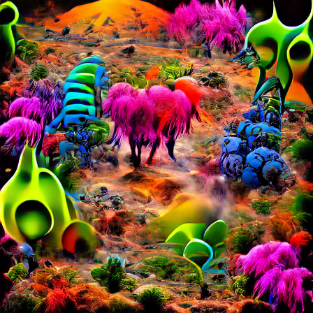
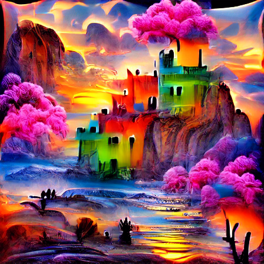
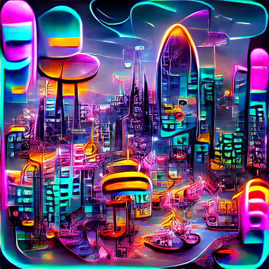

<h1 align="center">🎨 Text-to-Image Generation with CLIP + VQGAN</h1>

<p align="center">
  <b>Type a sentence, get an image.</b><br>
  A PyTorch project that combines OpenAI's CLIP and the VQGAN model to generate images from text prompts.
</p>

<p align="center">
  <a href="https://colab.research.google.com/github/Abdullah87146/image-generation-clip-vqgan/blob/main/image_generation_clip_vqgan.ipynb">
    
  </a>
  
  
  
</p>

---

## 🖼️ Results

<p align="center">
  
  &nbsp;
  
  &nbsp;
  
</p>

1. *"An alien planet with strange vegetation and creatures"*
2. *"A castle on a cliff at sunset, fantasy painting"*
3. *"A futuristic city at night with neon lights"*

All images were generated with `exclude = "realistic"` and `extras = "surreal, colorful"`.

---

## 🧠 How it works

| Step | What happens |
|:---:|---|
| 1️⃣ | **CLIP** (the "judge") turns the text prompt into numbers (an embedding). |
| 2️⃣ | **VQGAN** (the "painter") turns random starting numbers into an image. |
| 3️⃣ | The image is cut into many random crops, and CLIP checks how similar each crop is to the prompt. |
| 4️⃣ | The loss uses **cosine similarity**: be close to the prompt, stay away from the `exclude` text. |
| 5️⃣ | The optimizer (AdamW) slightly changes the starting numbers. Steps 2-5 repeat for 200 steps. |

---

## 🚀 Run it yourself (no installation needed)

1. Click the **Open in Colab** badge above.
2. Go to **Runtime → Change runtime type** and select a **GPU**.
3. Click **Runtime → Run all**.
4. The generated images appear in the notebook and are saved in the Colab `results/` folder.

> [!NOTE]
> A GPU is required. The first run also downloads the CLIP and VQGAN models, so it takes a few minutes.

---

## ⚙️ Settings you can change

All settings are in the **Settings** cell of the notebook.

| Setting | What it does |
|---|---|
| `include` | List of prompts. One image is generated per prompt. |
| `exclude` | What the image should *not* look like. |
| `extras` | Extra style words, e.g. `"surreal, colorful"`. |
| `total_steps` | How many improvement steps per image (more = slower, usually better). |
| `learning_rate` | How big each step is. |
| `noise_factor` | Amount of random noise added to the image crops. |
| `image_size` | Image height and width in pixels. |

---

## 📁 Project structure

```
├── image_generation_clip_vqgan.ipynb   # the full project (run it in Colab)
├── result_1.png                        # generated images
├── result_2.png
├── result_3.png
├── LICENSE
└── README.md
```

The large model files are downloaded automatically when you run the notebook, so they are not stored in this repository.

---

## 🛠️ Troubleshooting

| Problem | Solution |
|---|---|
| `No GPU found` | In Colab: **Runtime → Change runtime type**, choose a GPU, then run again. |
| The model download fails | The VQGAN files are hosted on a university server. Wait a few minutes and run the cell again. |
| Out of memory error | Lower `image_size` in the Settings cell (for example to `350`). |

---

## ⚠️ Limitations

- Needs a GPU, and generating each image takes a while.
- Results look abstract and painting-like. This method optimizes an image to match the text. It is not a modern text-to-image model such as Stable Diffusion.
- Every run gives a different image because the starting numbers are random.

---

## 📚 References

- [CLIP](https://github.com/openai/CLIP): Radford et al., *Learning Transferable Visual Models From Natural Language Supervision* (OpenAI, 2021)
- [VQGAN / Taming Transformers](https://github.com/CompVis/taming-transformers): Esser, Rombach and Ommer, *Taming Transformers for High-Resolution Image Synthesis* (CVPR 2021)

---

## 👤 Author

**Mohammad Abdullah**
GitHub: [@Abdullah87146](https://github.com/Abdullah87146)

<p align="center"><i>⭐ If you found this project interesting, feel free to give it a star!</i></p>
